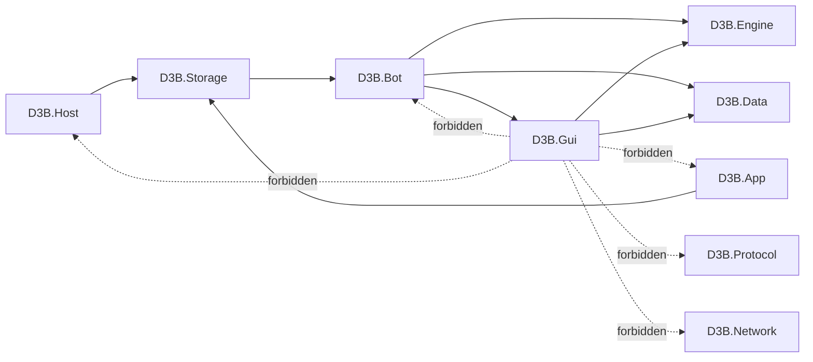

# P2N hybrid GUI architecture

P2N adds a GUI library and contracts for later supervised evaluation. The architecture below is the target direction;
the current code does not connect a planner to a live GUI executor.

## Target flow

Protocol Read-Only → CharacterState → World Planner → GUI Executor → official Dofus client → Protocol/Visual Feedback

- D3B observes and decodes protocol traffic into the character state. The official client remains responsible for
  creating requests caused by a future GUI action.
- The world planner uses D3B.Bot with the pure map and world algorithms in D3B.Engine and data in D3B.Data.
- The GUI executor is a future action boundary. It evaluates an immutable protocol snapshot, a current X11 window,
  a captured frame, calibration, and target evidence before considering one input.
- Server protocol observations and visual observations feed back to state and later planning. A visual animation alone
  does not confirm a server action.
- Existing D3B protocol injection remains a separate, existing path. P2N does not remove it or enable GUI gameplay.

## Project dependencies

Compile-time project references in the P2N slice:

| Project | References | Boundary |
| --- | --- | --- |
| src/D3B.Gui | D3B.Engine, D3B.Data | Platform and vision library. It has no dependency on Bot, Host, App, Protocol, or Network. OpenCV is supplied by the two central NuGet package references. |
| src/D3B.Bot | D3B.Gui, D3B.Engine, D3B.Data, D3B.Network, D3B.Protocol, and the existing bot dependencies | Owns character state, the bounded WalkToCell observation path, and the caller-invoked single-plan coordinator. The host does not register a capture loop or gameplay trigger. |
| src/D3B.Storage | D3B.Bot | Existing account/profile storage module used by the executable projects. |
| src/D3B.Host and src/D3B.App | D3B.Storage | These projects reach D3B.Bot through the existing storage dependency. Neither registers a GUI executor, capture loop, or gameplay trigger; D3B.Gui is transitive through D3B.Bot. |
| tests/D3B.Gui.Tests | src/D3B.Gui | Pure contracts and synthetic fixtures, plus Xvfb tests against fake windows. |
| tests/D3B.Bot.Tests | src/D3B.Bot | Bot-side tests, including actor-loop WalkToCell observation, outcome waiting, and isolated snapshot/correlation contracts. |

The required dependency direction is D3B.Gui → D3B.Engine and D3B.Data, then D3B.Bot → D3B.Gui. Forbidden
dependencies from D3B.Gui are D3B.Bot, D3B.Host, D3B.App, D3B.Protocol, and D3B.Network. D3B.Gui does not own a
BotActor, a client connection, or mutable character state.

## Public type map

| Folder | Public types and their roles |
| --- | --- |
| Windowing | IGameWindowLocator and X11WindowLocator inspect one caller-supplied XID. GameWindowExpectation supplies an executable expectation. GameWindowIdentity and GameWindowIdentityStatus describe the selected window and process check; GameWindowSnapshot is a point-in-time state and geometry observation. WindowLocalPixels, ClientAreaPixels, and DesktopPixels keep coordinate spaces distinct. |
| Capture | IWindowCapture is the seam; MaimWindowCapture is the X11 implementation; MaimCaptureOptions bounds the process and image; CaptureStatus names outcomes; CapturedFrame owns the decoded OpenCV image and before/after snapshots. |
| Calibration | LogicalCell wraps a Dofus cell identifier. ClientAreaGeometry records measured client offsets and dimensions. CalibrationAnchor, CalibrationAnchorRole, CalibrationAnchorSource, and CalibrationAnchorDocument represent annotated inputs. CalibrationEnvironment and CalibrationRequest describe a validation run. AffineScreenMapper, CalibrationValidator, CalibrationProfile, CalibrationResult, CalibrationStatus, CalibrationMetrics, CalibrationProblem, and CalibrationProblemCode implement fitting, evidence, and invalidation. |
| Vision | ITargetLocator is the seam; TemplateTargetLocator performs bounded template matching. TargetExpectation carries logical and visual search inputs. TargetRegion binds a candidate to one frame and calibration. TargetConfidence records scores and thresholds; TargetStatus and TargetEvidence explain verification; WindowLocalRect is an image-local rectangle. |
| Input | IGuiInput is the input seam. DisabledGuiInput refuses input. XdotoolGuiInput emits desktop-wide XTest input after window and focus checks. GuiInputResult and GuiInputStatus report its outcome. |
| Actions | GuiActionIntent identifies one WalkToCell or UseElement request and its expected client/server observations. GuiActionExecutor consumes each identifier once and sends at most one click. GuiActionOutcome and GuiActionOutcomeStatus record the terminal state. GuiClientAction and GuiServerOutcome are protocol-neutral matching categories. IGuiOutcomeConfirmation is the confirmation seam; NeverConfirms is the P2N default. |
| Safety | GuiOptions and GuiOptionsValidator describe bounded configuration, with GuiOptionsValidation returning problems. GuiActionGate classifies readiness and GuiReadiness binds that result to its inputs. GuiSafetyReason names every first-failing condition. GuiWorldSnapshot and GuiKnownElement are immutable protocol observations; GuiCellProvenance and ProtocolObservationStatus describe their evidence. GuiBackend and GuiMode name the available backend and mode. GameInputMode, GuiInputModePolicy, IGameInputRequestClassifier, GameInputRequestSource, and GameInputRequestClassification model the future protocol-admission boundary. |
| Reporting | GuiPreviewReport and GuiPreviewVerdict describe offline results. PreviewOverlayRenderer draws annotations. PreviewOutputGuard checks output paths; PreviewOutputWriter writes private artifacts. |

## Important seams and current status

- Windowing, capture, calibration, vision, input, action execution, safety, and reporting are separate interfaces or
  components. The preview script composes image-file input, anchor loading, calibration, optional template matching,
  annotation, and JSON reporting. It does not use a live window locator or input implementation.
- GuiWorldSnapshotAdapter reads one atomically published BotActor view and creates an immutable GUI snapshot. OpenCV
  receives that snapshot as data; the image pipeline does not receive a mutable BotActor.
- GuiIntentCorrelation models registration, acknowledgement, one click, a compatible client request, a server
  outcome, and final consumption. BotActor feeds WalkToCell observations on its existing inbox and exposes one
  outcome waiter. PlayerActions still pauses a running behavior on client gameplay requests; the observer does not send
  requests or modify GameSession's transport.
- BotActor owns a shared GuiClickLease for the active intent. Bots.OnFrame cancels it synchronously when an unread frame
  closes the session translation latch, before posting the actor inbox notification. XdotoolGuiInput calls
  TryBeginClick after pointer movement and focus revalidation, immediately before Process.Start; this is the atomic
  linearization point against revocation. A later cancellation cannot retract a click whose launch point already won,
  so that result is uncertain and remains terminal.
- A successful MarkClicked gate consumes the session epoch's one permitted GUI click attempt. Pre-click intents that
  never open that gate may be replaced; an opened gate cannot be retried in the same epoch, including after timeout.
  Attach or reconnect advances the epoch and resets the allowance.
- GuiProtocolTrustPolicy is one required evidence check, not standalone authorization. The coordinator separately
  validates the same-map plan path and its agreement with the verified target cell before it registers or delegates a
  click.
- GameInputModePolicy is a pure policy seam. It is not installed at the relay's final network admission point.
- The executor defaults to NeverConfirms. A click without a matching confirmation ends Unconfirmed and cannot be
  retried with the same intent identifier.

## Offline Preview flow

1. Read a local PNG and a version 1 anchor JSON file; an optional element requires a local template and cell.
2. Validate anchor counts, map/build input, geometry, affine fit, independent validation residuals, and freshness.
3. If requested and calibration passes, run bounded template matching around the projected cell.
4. Render the overlay and write preview.png plus report.json under a private output directory.
5. Report a calibration or target verdict with explicit synthetic provenance when the fixture is synthetic.

Both the output guard and writer walk upward from the destination and reject paths beneath an ancestor marked by
`D3B.slnx`, regardless of the current working directory. The default is a private child of the user's local share
directory; the writer uses mode 0700 for the directory and 0600 for files. Preview never captures a desktop window or
emits input.

## Not wired in P2N

There is no host or application registration for GuiActionExecutor, XdotoolGuiInput, or an automatic capture loop.
There is no gameplay trigger, no schedule, and no gameplay call from a planner into the GUI library. D3B.Bot observes
WalkToCell protocol evidence only; it does not cause client requests. UseElement correlation remains contract-only. The
GuiClientInput policy is not connected to the network admission point. No real Dofus capture, click, move, harvest, or
server session was performed.
